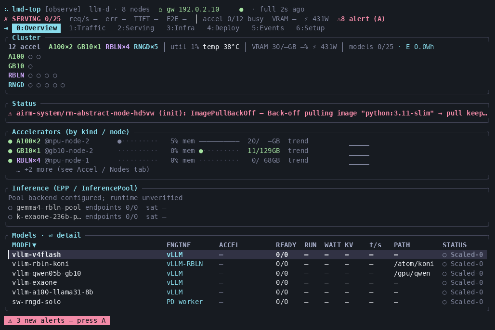
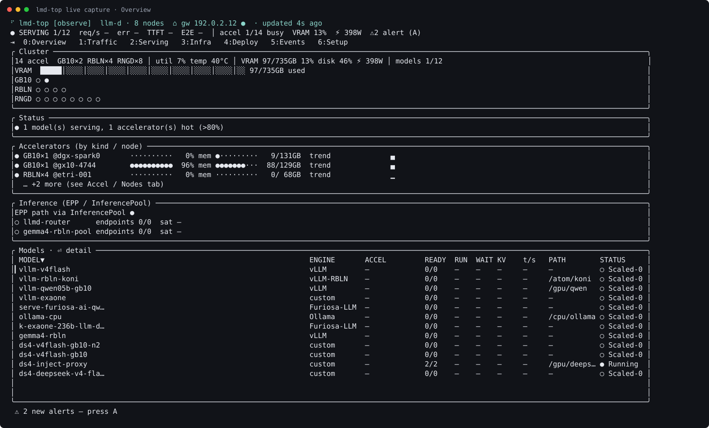
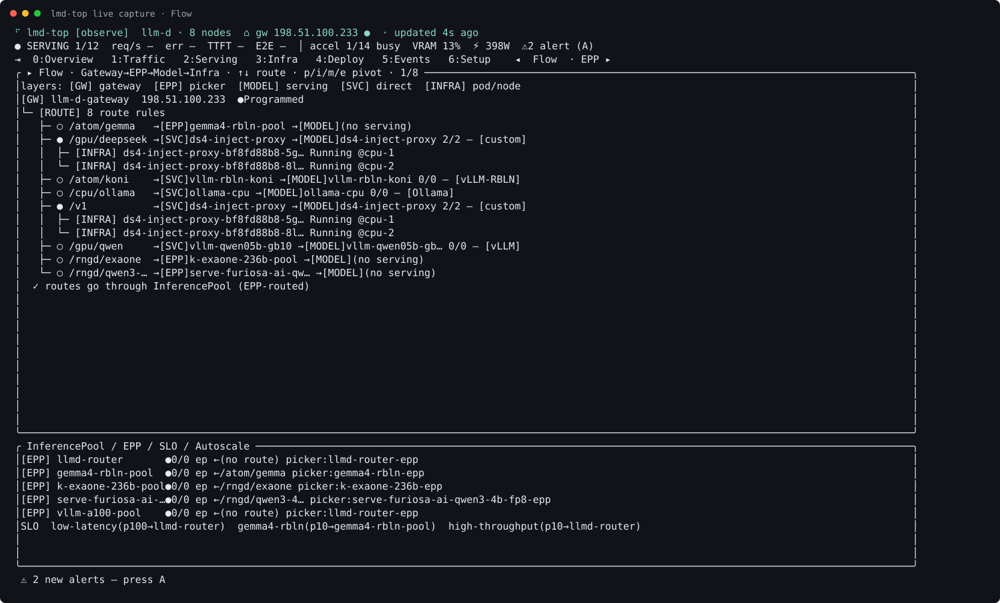
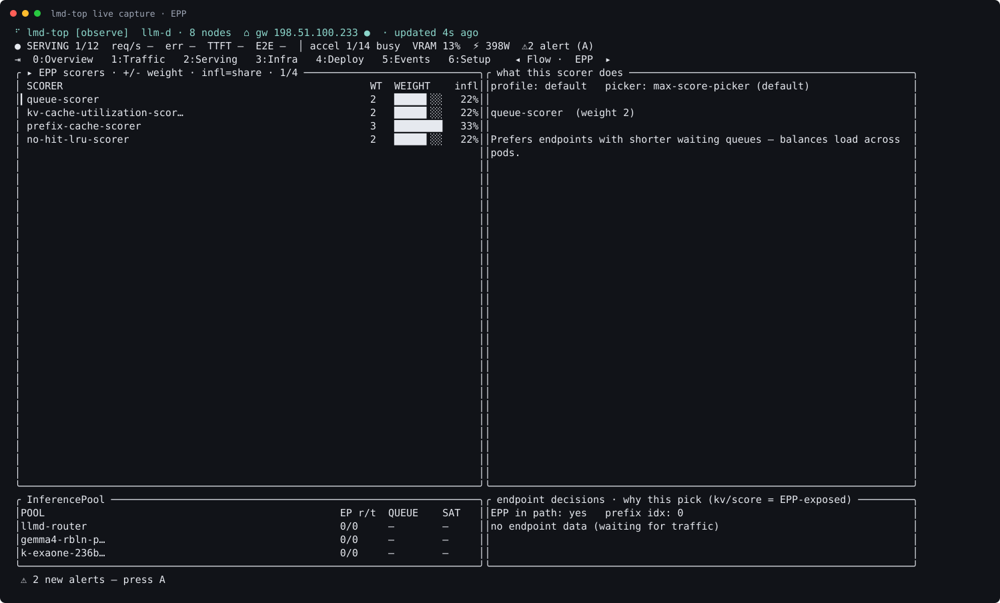
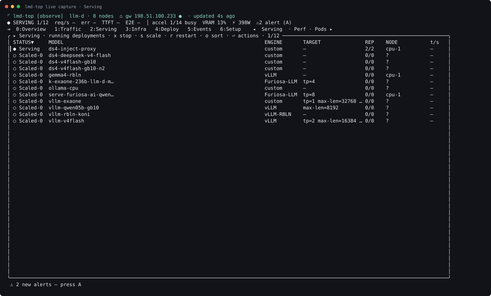
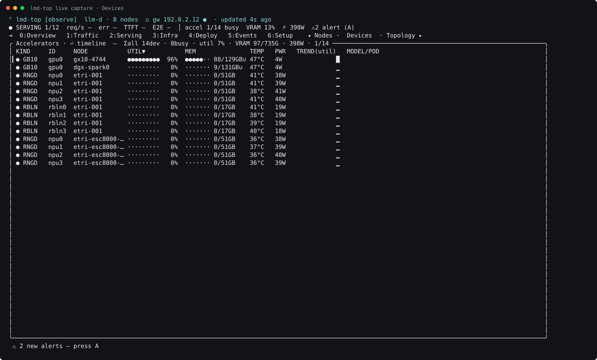
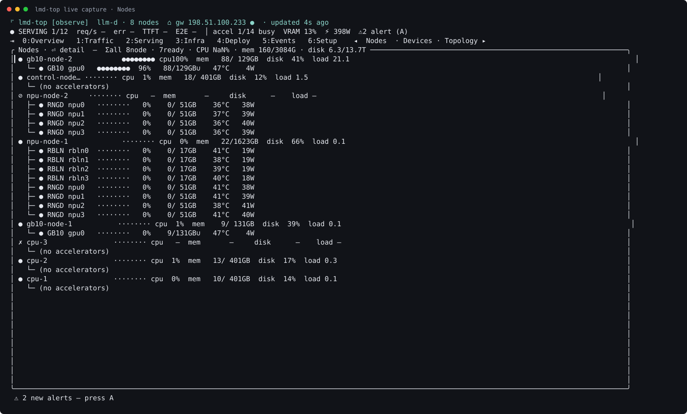
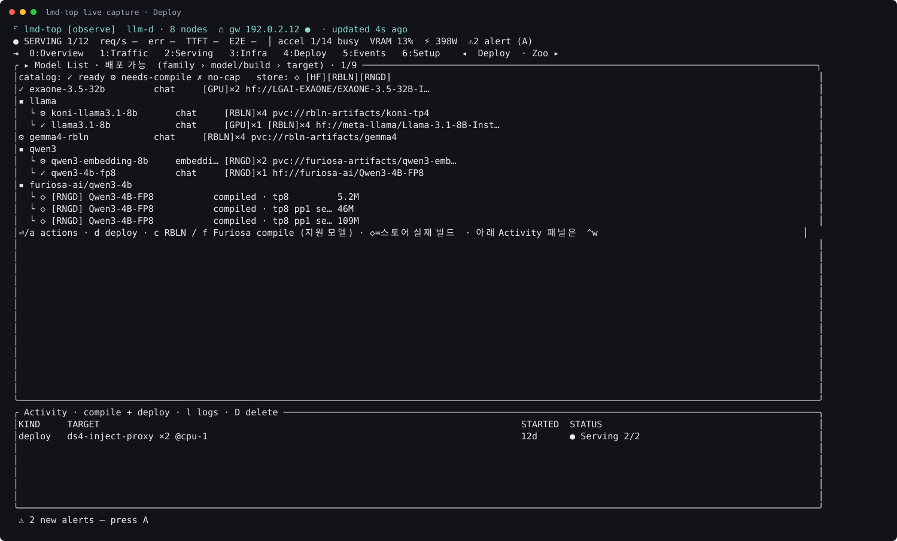
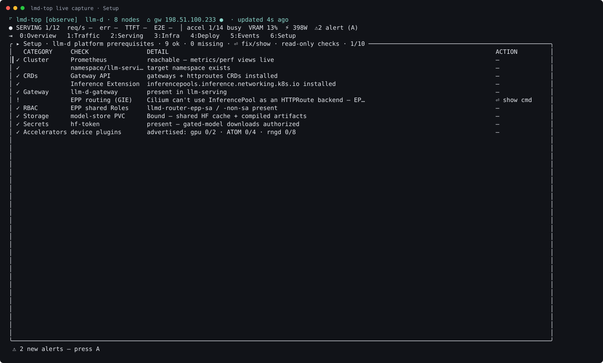

# llm-d 사내 환경 가이드

> 대상: llm-d를 처음 접하는 사람 · 작성 기준: 2026-07-13  
> 읽는 순서: 요약 → llm-d → 우리 인프라 → lmd-top · IP·스크린샷은 부록

---

## 0. 먼저 이것만

우리는 Kubernetes 위에서 **OpenAI 호환 LLM API**를 돌리는 사내 추론 플랫폼을 운영합니다. 들어올 문은 하나입니다 — `http://<gateway-host>`. 그 뒤에서 GPU(GB10), NPU(Rebellions RBLN / Furiosa RNGD), CPU가 path에 따라 나뉩니다. 관측은 Grafana와 터미널 도구 **lmd-top**으로 합니다.

지금(2026-07-13) 게이트웨이·EPP·메트릭 같은 **플랫폼은 켜져 있고**, 대부분의 모델 Deployment는 **replicas=0**으로 대기 중입니다. 필요할 때 scale-up 하면 됩니다.

```
클라이언트 ──▶ Gateway(.233) ──path──▶ (EPP) ──▶ 모델 Pod ──▶ GPU/NPU/CPU
                 ▲                              │
            lmd-top / Grafana ◀── Prometheus ◀──┘
```

---

## 1. llm-d가 뭔가

### 왜 이런 게 필요한가

GPU 한 대에 `vllm serve`를 띄우는 방식은 시작할 때 가장 쉽습니다. 다만 모델이 늘고, GPU와 NPU가 섞이고, 같은 모델을 replica 여러 개로 돌리기 시작하면 이야기가 달라집니다. 포트를 손으로 나누고, 벤더마다 스크립트가 갈라지고, 로드밸런서는 round-robin만 해서 **KV cache나 대기 큐**를 모릅니다. 그러다 TTFT가 들쭉날쭉해지고, 장애가 나면 Gateway인지 모델인지 카드인지 도구를 옮겨 다니며 봐야 합니다.

**llm-d**([llm-d.ai](https://llm-d.ai/docs))는 그 문제를 Kubernetes 위에서 **플랫폼처럼** 다루기 위한 스택입니다. 기반은 Gateway API와 Gateway API Inference Extension(GIE)입니다. 핵심 문장 하나만 기억하면 됩니다.

> 모델 서버는 Pod로 두고, **EPP(Endpoint Picker)** 가 “이번 요청을 어느 Pod로 보낼지” 고른다.

일반 HTTP 로드밸런서가 path나 라운드로빈만 보는 것과 달리, llm-d/GIE는 요청 body의 모델 이름, KV cache 사용량, 큐 길이, 요청 중요도 같은 **추론 맥락**을 보고 스케줄합니다.

### 요청이 흐르는 길

요청은 대략 네 층을 지납니다.

```
L1  Gateway + HTTPRoute   ← 문과 안내판 (path로 어디로 보낼지)
L2  InferencePool + EPP   ← 창구 줄 + 배정원 (Filter → Score → Pick)
L3  Model Server Pod      ← 주방 (vLLM / vLLM-RBLN / furiosa-llm / …)
L4  Accelerator           ← 하드웨어 (GPU / RBLN / RNGD / CPU)
```

**Gateway**는 클러스터 밖 HTTP를 받는 정문입니다. 우리 환경에서는 Envoy Gateway(`eg`)가 `llm-d-gateway`를 돌리고, Cilium L2로 `<gateway-host>`을 광고합니다.  
**HTTPRoute**는 그 정문 안의 안내판입니다. `/atom/gemma`는 RBLN 풀로, `/gpu/qwen`은 GB10 쪽으로, `/v1`은 inject-proxy로 — URL path로 백엔드를 고릅니다.

**InferencePool**은 “이 모델을 서빙하는 Pod들의 집합”입니다. Kubernetes Service와 비슷해 보이지만, 직접 round-robin하지 않고 **EPP에게 선택을 맡깁니다**.  
**EPP**는 Envoy `ext_proc`으로 Gateway에 붙는 스케줄러입니다. 요청이 올 때마다 Pod들을 걸러 내고(Filter), scorer로 점수를 매기고(Score), 가장 높은 쪽을 고릅니다(Pick).  
그다음 **모델 서버**가 실제로 토큰을 만들고, **device-plugin**이 노드의 GPU/NPU를 `nvidia.com/gpu`, `rebellions.ai/ATOM`, `furiosa.ai/rngd` 같은 K8s 리소스로 붙여 줍니다.

참고로 모든 path가 EPP를 거치지는 않습니다. 우리 `/v1`처럼 Service로 직결되는 경로도 있습니다. EPP를 도는지 여부는 lmd-top의 Traffic → Flow에서 바로 보입니다.

### EPP는 어떻게 Pod를 고르나

우리 설정은 **max-score-picker**입니다. 여러 scorer가 낸 점수를 가중 합산해서 가장 높은 Pod로 보냅니다.

```
요청 ──▶ Filter ──▶ Score(가중 합) ──▶ Pick ──▶ 그 Pod로 프록시
```

대기 큐가 짧은 쪽을 선호하는 **queue-scorer**(가중치 2), KV cache에 여유가 있는 쪽을 선호하는 **kv-cache-utilization-scorer**(2), 같은 prompt prefix가 이미 있는 쪽을 선호하는 **prefix-cache-scorer**(3, 가장 큼 → TTFT에 유리), cache miss 때 LRU 쪽을 보는 **no-hit-lru-scorer**(2, llm-d v0.7)가 함께 돌아갑니다.

설정은 ConfigMap `*-epp`의 `default-plugins.yaml`에 있고, 이미지는 `ghcr.io/llm-d/llm-d-router-endpoint-picker-dev:main`입니다. 풀마다 EPP Deployment가 따로 있을 수 있습니다(`llmd-router-epp`, `gemma4-rbln-epp` 등).

그 밖에 **InferenceObjective**는 “이 트래픽이 얼마나 중요한가”를 정수 priority로 표현합니다. 우리에는 `low-latency`(100), `high-throughput`(10) 등이 있습니다. 이름과 달리 latency SLO 숫자 필드가 있는 CR은 아니고, 혼잡 시 보호 순서에 가깝습니다.  
**Prometheus**와 각종 exporter(DCGM, RBLN, Furiosa, vLLM, EPP)는 이 전체의 “눈”이고, Grafana와 lmd-top이 그걸 읽습니다.

### GPU와 NPU를 같이 쓰는 이유

NVIDIA GPU는 weight만 올리면 바로 서빙할 수 있어 새 모델 PoC에 편합니다. RBLN·Furiosa 같은 NPU는 보통 **사전 컴파일**이 필요하지만 전력·비용 면에서 고정 서빙에 유리합니다. llm-d에서는 둘 다 같은 Gateway 뒤에 두고, path만 `/gpu/*`, `/atom/*`, `/rngd/*`로 갈라 씁니다.

---

## 2. 우리 인프라

사내망에 노드 여러 대를 묶고, **Gateway `.233` 하나**로 API를 받으며, **NAS**에 모델 스토어를 두고, Prometheus로 관측하는 구조입니다. Kubernetes는 v1.31, CNI는 Cilium, 서빙 네임스페이스는 `llm-serving`입니다.

### 큰 그림

```
 클라이언트 / Open WebUI
           │
           ▼
    Gateway LB .233 ──── Cilium L2 ARP
           │
           ├─ /gpu/*    → GB10 · inject-proxy
           ├─ /atom/*   → RBLN (+EPP)
           ├─ /rngd/*   → Furiosa (+EPP)
           └─ /cpu/*    → ollama
           │
     ┌─────┴──────┬──────────┬──────────┐
     ▼            ▼          ▼          ▼
  GB10×2     npu-node-1  npu-node-2  CPU×3
  .175.*     RBLN+RNGD   RNGD×2+A100×2 EPP·proxy
                 │
                 ▼
            NAS .186.114  (SMB model-store · NFS RAG)

  exporters → Prometheus(.105:30090) → Grafana · lmd-top
  Rancher / Headlamp / Hubble → 관리 UI (.105 NodePort)
```

클라이언트가 `.233`으로 들어오면 HTTPRoute가 path로 나눕니다. `/atom/*`·`/rngd/*`는 InferencePool과 EPP를 거쳐 해당 NPU 노드의 모델 Pod로 가고, `/gpu/*`는 GB10이나 inject-proxy 쪽, `/cpu/*`는 ollama로 갑니다. EPP는 모델 Pod의 `/metrics`를 읽어 큐와 KV를 보고 Pod를 고릅니다. 모델 Pod는 device-plugin으로 카드를 받고, weight·컴파일 산출물은 NAS SMB에 물린 `model-store` PVC에서 가져옵니다.

관측 쪽에서는 노드·가속기·vLLM·EPP exporter가 Prometheus(`<cp-node-ip>:30090`)로 모이고, Grafana(`:30300`)와 lmd-top이 그걸 봅니다. 클러스터 관리는 Rancher(`:30443`), Headlamp, Hubble이 control-plane NodePort로 열려 있습니다. 멀티테넌트는 `tenant-a` / `tenant-b`와 Rancher RBAC로 나눕니다.

### 망과 노드

주 사내망은 `<site-subnet>`입니다. control-plane(R7525 `.105`), etri·CPU 워커, Gateway `.233`이 여기 있습니다. GB10 두 대(`gb10-node-1`, `gb10-node-2`)는 `<gb10-subnet>`에 있고, 모델·문서 저장소 NAS는 `<nas-host>`입니다. Pod/Service CIDR은 `<pod-cidr>` / `<svc-cidr>`(Cilium)입니다.

역할만 짧게 말하면 — **R7525**는 관리·API·UI, **npu-node-1**은 RBLN×4와 RNGD×3을 가진 NPU 주력 노드, **npu-node-2**는 RNGD×2와 A100 80GB×2를 가진 노드(A100은 2026-10-15 npu-node-1에서 옮겨진 것을 확인하고 K8s에 `nvidia.com/gpu: 2`로 복구), **GB10 두 대**는 GPU 서빙, **cpu-1/2/3**은 EPP·proxy·ollama를 올리는 CPU 풀입니다.

### 지금 열려 있는 path

기본 `/v1`과 `/gpu/deepseek`는 `ds4-inject-proxy`로 연결되어 있고, 캡처 시점 기준 이 proxy만 **2/2로 기동** 중입니다. `/gpu/qwen`(GB10 vLLM), `/atom/gemma`·`/atom/koni`(RBLN), `/rngd/exaone`·`/rngd/qwen3-4b-fp8`(Furiosa), `/cpu/ollama`는 라우트와 풀(또는 서비스)은 준비돼 있으나 모델 replica는 0입니다. 정확한 IP·UI URL·curl 예시는 **부록 A**에 모아 두었습니다.

---

## 3. lmd-top

### 무엇을 하는 도구인가

Grafana는 차트를, k9s는 Pod를, nvidia-smi류는 카드만 잘 봅니다. 장애나 용량 문제를 가르려면 사실 **Gateway → EPP → 모델 → 하드웨어**를 한꺼번에 봐야 하는데, 그때마다 도구를 옮겨 다니게 됩니다.

**lmd-top**은 그 네 계층을 한 터미널 화면에서 상관해서 보여 주는 llm-d 전용 TUI입니다. 자체 데이터베이스는 없고, Prometheus와 kubectl만 읽습니다. 이 클러스터에서는 `LMD_PROM=<cp-node-ip>:30090`, `LMD_NS=llm-serving`이면 됩니다.

### 화면과 llm-d 계층

숫자키로 섹션을 고르고, 좌우 화살표로 서브탭을 옮깁니다. 보통은 **0 Overview**부터 보면 됩니다.

```
L1 Gateway   →  1 Traffic ▸ Flow
L2 EPP       →  1 Traffic ▸ EPP
L3 Model     →  2 Serving (Perf / Pods)
L4 Infra     →  3 Infra   (Nodes / Devices)
올리기        →  4 Deploy  (Library / Zoo)
점검         →  6 Setup   (Doctor)
한눈         →  0 Overview
```

**Overview**는 노드·가속기 LED, VRAM, 풀, 모델 수, 한 줄 진단을 한눈에 줍니다.  
**Traffic → Flow**는 Gateway에서 path를 타고 `[EPP]` 또는 `[SVC]`를 거쳐 pod까지 이어지는 트리입니다. 라우팅이 이상한지, EPP를 우회하는지 볼 때 씁니다. 옆 서브탭 **EPP**는 scorer 가중치와 풀 endpoint를 보여 줍니다.  
**Serving**은 실제로 켜진(또는 꺼진) 배포 목록입니다. 여기서 scale / restart를 하고, Perf 서브탭에서 지연이 어디서 쌓이는지, Pods에서 llm-serving 파드를 봅니다.  
**Infra**는 노드 헬스와 디바이스별 util·온도·전력입니다.  
**Deploy**는 “돌리기”가 아니라 “올리기” — NPU 컴파일·카탈로그·배포 Activity입니다.  
**Events**는 최근 이벤트, **Setup**은 Gateway CRD·PVC·device-plugin 같은 플랫폼 전제조건을 Doctor처럼 점검합니다.

상태 표시는 대략 `●` 서빙, `○` 꺼짐/유휴, `◐` 진행 중, `⚠` 경고, `✗` 실패입니다.

### 이럴 때는 여기

클러스터가 괜찮은지 먼저 보려면 Overview.  
`/atom/gemma`가 정말 EPP를 도는지 확인하려면 Traffic → Flow.  
scorer 비중을 보려면 Traffic → EPP (`+`/`-`는 로컬 시뮬레이션이고 클러스터에 바로 쓰이지는 않음).  
모델을 켜려면 Serving에서 행을 고르고 Enter → Scale (`lmd-top --mode admin`).  
느리다면 Serving → Perf, 카드가 뜨거운지 보려면 Infra → Devices.  
RBLN을 컴파일해 올리려면 Deploy, Gateway나 PVC가 빠졌는지 보려면 Setup.

### 실행과 권한

```bash
export LMD_PROM=<cp-node-ip>:30090 LMD_NS=llm-serving
lmd-top                 # 기본: 읽기 전용(observe)
lmd-top --mode admin    # scale / restart / compile apply
lmd-top --snapshot      # 텍스트로 한 번 요약
lmd-top --doctor        # Prometheus 메트릭 커버리지
```

권한은 `observe`(보기) → `debug`(로그 추가) → `admin`(scale·restart·compile/deploy apply) → `danger`(삭제류) 순으로 풀립니다. 변경 확인 팝업의 기본값은 **No**이고, 적용 내용은 `~/.config/lmd-top/audit.log`에 남습니다.

자주 쓰는 키만 말하면 — `0`–`6` 또는 Tab으로 섹션, 좌우로 서브탭, 위아래와 Enter로 선택·액션, `/` 필터, `y` YAML, `l` 로그, `?` 도움말, `q` 종료, `:graf`로 Grafana입니다.

### 라이브 화면



아래는 이 클러스터에서 캡처한 Overview입니다. 8노드, Gateway `.233`, SERVING 1/12, 가속기 14장 요약이 한 화면에 나옵니다. Flow·EPP·Serving·Devices 등은 **부록 B**에 캡션과 함께 두었습니다.



---

## 4. 자주 쓰는 명령

```bash
# 모델 켜기
kubectl -n llm-serving scale deploy/vllm-rbln-koni --replicas=1

# 라우트 확인
kubectl -n llm-serving get gateway,httproute,inferencepool

# 관측
lmd-top --snapshot
lmd-top --doctor
```

---

## 5. 지금 알아둘 한계

모델 서버는 대부분 꺼져 있고 플랫폼만 hot입니다. A100 ×2는 npu-node-2에 있으며 `runtimeClassName: nvidia` + `nodeSelector: kubernetes.io/hostname=npu-node-2`로 씁니다. LoadBalancer IP는 IT가 할당해 준 `.233`만 쓰고, 임의 IP를 올리면 안 됩니다.

더 읽기: [PLAYBOOK](../PLAYBOOK.md) · [STATUS](../STATUS.md) · [lmd-top README](../lmd-top/README.ko.md) · https://llm-d.ai/docs

---
---

# 부록

## A. 접속 · IP · 호출 (복붙용)

### 관리 UI

- Rancher — https://<cp-node-ip>:30443  
- Headlamp — http://<cp-node-ip>:30502  
- Grafana — http://<cp-node-ip>:30300  
- Prometheus — http://<cp-node-ip>:30090  
- Hubble — http://<cp-node-ip>:30081  

### 노드

- `control-node` — <cp-node-ip> — control-plane  
- `npu-node-1` — <npu-node-1-ip> — RBLN×4, RNGD×3  
- `npu-node-2` — <e11-ip> (SSH 포트 10022) — RNGD×2, A100 80GB×2  
- `gb10-node-1` — <gb10-a-ip> — GB10×1  
- `gb10-node-2` — <gb10-b-ip> — GB10×1  
- `cpu-1` / `cpu-2` / `cpu-3` — .178 / .179 / .186 — EPP·proxy  

### path → 백엔드

- `/v1`, `/gpu/deepseek` → ds4-inject-proxy (**2/2** 기동)  
- `/gpu/qwen` → vllm-qwen05b-gb10 (0)  
- `/atom/gemma` → gemma4-rbln-pool + EPP (0)  
- `/atom/koni` → vllm-rbln-koni (0)  
- `/rngd/exaone` → k-exaone-236b-pool + EPP (0)  
- `/rngd/qwen3-4b-fp8` → furiosa qwen3 pool + EPP (0)  
- `/cpu/ollama` → ollama-cpu (0)  

### 스택 · EPP 설정

kubeadm 1.31 · Cilium · Envoy Gateway · llm-d EPP v0.7 · nvidia/rbln/furiosa device-plugin · kube-prometheus · KEDA · Rancher · model-store PVC(NAS SMB).  
EPP 플러그인: ConfigMap `*-epp` → `default-plugins.yaml`.

### 호출 예

```bash
curl -s http://<gateway-host>/v1/models | jq .

curl -s -X POST http://<gateway-host>/atom/koni/chat/completions \
  -H 'Content-Type: application/json' \
  -d '{"model":"koni-llama3.1-8b-rbln","messages":[{"role":"user","content":"안녕"}],"max_tokens":64}'
```

```python
from openai import OpenAI
client = OpenAI(base_url="http://<gateway-host>/v1", api_key="dummy")
print(client.models.list())
```

---

## B. lmd-top 스크린샷

재생성: `bash scripts/capture-lmd-top.sh docs/images`  
텍스트 스냅샷: [lmd-top-snapshot.txt](lmd-top-snapshot.txt)

추천 순서: Flow(경로) → EPP(채점) → Serving(모델) → Devices(하드웨어).

**Flow** — Gateway에서 route를 타고 `[EPP]` 또는 `[SVC]`로 이어집니다. ●는 Ready, ○는 scaled-0.



**EPP** — scorer 가중치와 풀 endpoint. 모델이 꺼져 있으면 “waiting for traffic”이 정상입니다.



**Serving** — `● Serving`과 `○ Scaled-0`. admin 모드에서 Scale/Restart.



**Devices** — GB10·RBLN·RNGD 14장의 util/mem/temp/power. `∪`는 통합 메모리.



**Nodes** — 노드 CPU·메모리·load.



**Deploy** — Library(카탈로그)와 Activity(compile/deploy 진행).



**Setup** — 플랫폼 Doctor (`✓` / `!` / `✗`).



저장소: `scripts/`(설치·캡처), `manifests/`(Gateway·모델·EPP), `lmd-top/`(소스), `docs/images/`(스크린샷), `STATUS.md` / `PLAYBOOK.md` / `FEATURES.md`(현황·활용·기능).
