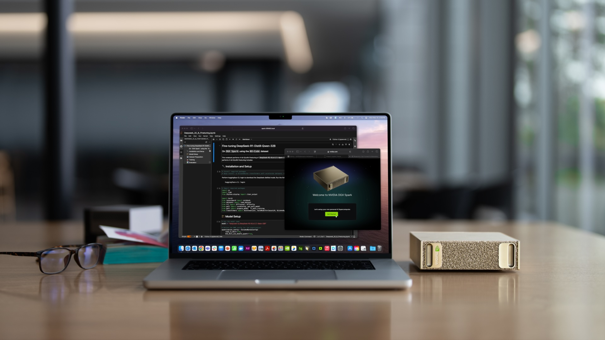
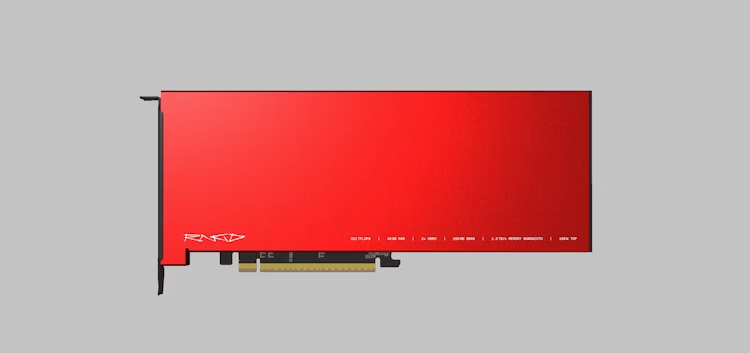
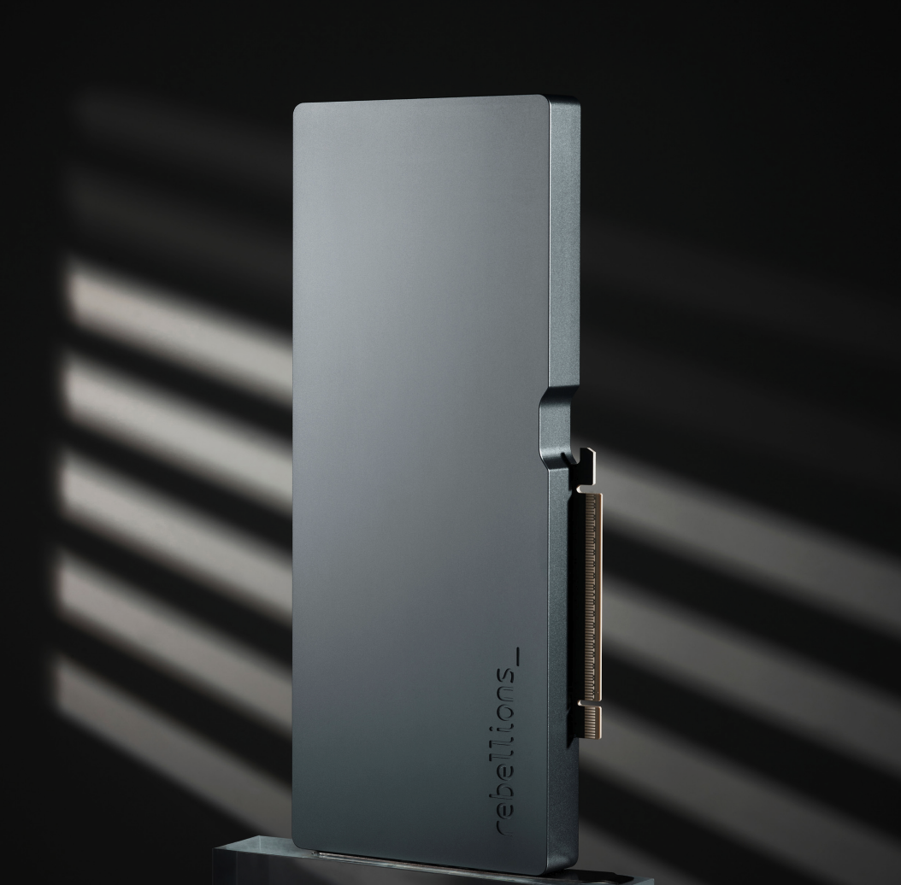
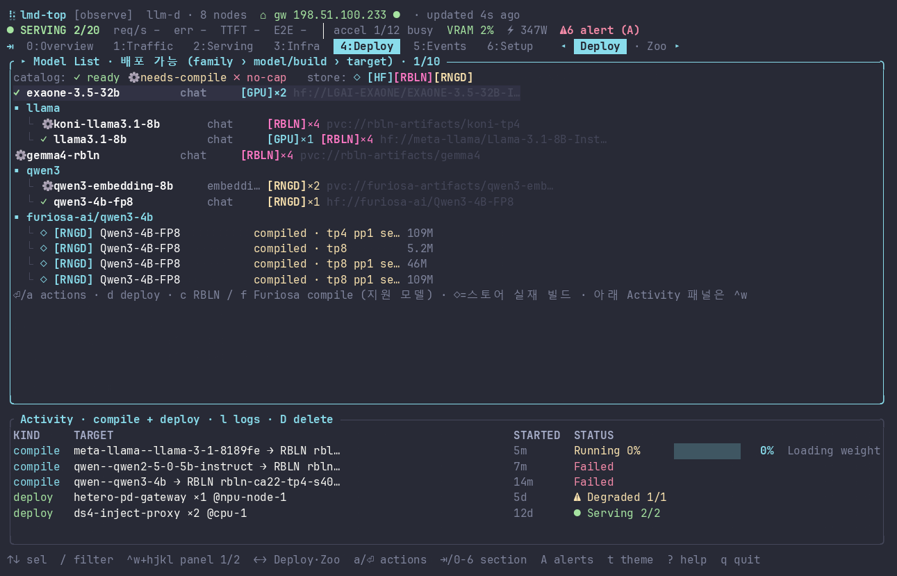

# 승인된 구성 — ETRI NPU 실행·자원관리

상태: 사용자 구성·이미지 배치·스타일·내장 이미지 생성 백엔드·샘플 및 전체 제작 승인 완료. 최종 제작과 검수 진행 중.
대상: 공동연구 접점을 찾는 기술 미팅. 과제 총괄 설명과 상세 벤치 수치는 제외.
핵심 이야기: 이종 자원 환경에서 모델과 실행 단계를 배치하려면 준비 조건과 실행 내부를 알아야 한다. 우리는 이를 분석하고 실행을 바꿀 수 있는 도구·런타임, 운영 도구를 구현했다.

## Slide 1 — 우리가 작업하는 전체 계층
- 역할: 전체 지도. 표지·목차 별도 없음.
- 모델·서비스 / 모델 운영 / 컴파일·런타임 / GPU·NPU의 4계층.
- 활용 기반은 하드웨어·Kubernetes·Prometheus·벤더 엔진.
- ETRI 작업은 저수준 분석·커스텀 실행·KV 전송·lmd-top 영역으로 강조.
- 이후 슬라이드는 이 지도의 특정 계층을 확대한다. 실제 단일 통합 제품의 연결도와는 구분.
- 다음 질문: 왜 장비 선택만으로 자원 관리가 끝나지 않는가?
- 필수 이미지: 하드웨어 세 종류는 작지만 구별 가능하게 사용. 제조사 대표 이미지, 현장 사진 아님.
  - 
  - 
  - 
  - 
  - 

## Slide 2 — NPU에서는 실행 조건도 자원 관리의 대상
- 역할: 문제를 하나로 좁히는 개념 그림.
- 같은 모델도 입력 shape·병렬성·컴파일 설정에 따라 실행 아티팩트가 달라짐.
- 우리는 bucket·병렬성에 따른 성능과 준비 비용을 비교함.
- 그림은 모델 → 실행 조건별 아티팩트 → 장비 배치. 표·수치 그래프 없음.
- 다음 질문: 실행 조건과 비용을 이해하려면 어디까지 내려가 봐야 하는가?
- 근거: 워크샵 예시 4–5, 7–13장. 사용한 NPU 경로에 한정하며 GPU 대비 일반 우열 주장 없음.

## Slide 3 — 컴파일·실행 내부의 개입 지점을 분석
- 역할: 전체 지도 중 컴파일·런타임 계층 확대.
- 모듈/연산 → 저수준 IR·메모리 → 실행 아티팩트의 세 단계.
- DSL·Rust LIR의 연산 매핑과 HBM↔DM 이동을 조사.
- 단계 이름은 한글 개념 우선, 상세 API·L1~L8 분류는 노트.
- 다음 질문: 분석한 지점에 우리 코드를 실제로 연결할 수 있는가?
- 근거: custom_kernel 예시 5, 7–14, 19장. 벤더 컴파일러 전체 구현으로 확대하지 않음.

## Slide 4 — 커스텀 실행 코드를 기존 엔진에 연결
- 역할: 우리가 만든 결과물 ①, 교체 전/후 그림.
- 기존 artifact의 한 stage만 자체 코드로 교체하는 L8Swapper 구현.
- 입력·출력 규격 확인 → 바이너리 교체 → 기존 엔진에서 dispatch 확인.
- 도구 이름보다 '일부 실행을 바꿔볼 수 있는 경로 확보'에 집중.
- 다음 질문: 한 stage를 바꾸는 것에서, 실행 단계를 다른 장비로 나누는 것까지 가능한가?
- 근거: custom_kernel 예시 11, 13, 19장. Rust passthrough dispatch를 완성 attention 검증으로 혼동하지 않음.

## Slide 5 — 실제 KV 전달로 NPU 간 실행을 분리
- 역할: 우리가 만든 결과물 ②, P→KV→D 한 개의 큰 도식.
- 직접 KV를 관리하는 런타임·커넥터로 decode를 이어감.
- Furiosa/Rebellions 동종·이종 조합과 역할 교환.
- KV 유지·연산 배치·컴파일 조건을 바꾸며 비용을 분석. 세부 최적화 목록은 노트.
- 다음 질문: 이런 모델·실행 환경을 어떻게 준비하고 운영하는가?
- 근거: PD history §§4–7. 실제 NPU PD와 과거 GPU–NPU 가능성 검토는 구분. PD는 IR 자체가 아님.

## Slide 6 — 모델 준비와 운영을 lmd-top으로 연결
- 역할: 전체 지도에서 운영 계층으로 다시 올라옴. 도구 전용은 이 1장.
- 모델·컴파일 산출물 구분 / 컴파일·배포 작업 / 실행·자원 관측의 3가지 설명.
- 실제 컬러 TUI를 크게 사용. UI 글자·수치·상태를 생성 모델이 바꾸면 불합격.
- lmd-top은 벤더 compile Job을 관리하며 PD 런타임을 자동 통합 제어한다고 주장하지 않음.
- 다음 질문: 이 분석·실행·운영 기반 위에서 무엇을 공동 연구할 수 있는가?
- 필수 이미지: 실제 컬러 PTY 녹화 프레임. 데이터 합성 없이 보존해야 하는 엄격한 입력.
  - 

## Slide 7 — 다음 연구는 조건·단계·장비를 함께 선택하는 정책
- 역할: 1장의 전체 지도로 복귀. 완료 작업과 제안을 구분.
- 확보한 것: 실행 조건 분석 / 커스텀·PD 실행 경로 / 모델 운영 도구.
- 협업 접점: 비용 예측과 실행 조건 탐색 / KV 이동을 고려한 단계·장비 배치.
- 결론: 어떤 모델·부하를 어떤 조건과 자원 조합으로 실행할지 공동 연구.
- 자동 최적화 컨트롤러 완성이나 단일 통합 제품을 주장하지 않음.

## 정보량 원칙

한 장 한 주장, 중심 그림 한 개, 설명은 세 덩어리 이내. API 이름·실험 수치·조건·주의사항은 발표자 노트로 이동. 연계 문장은 노트의 마지막 문장으로 넣고 모든 장 하단에 긴 문장을 반복하지 않는다.

## 승인 기록

7장 순서와 이미지 배치(1장 장비·기반 로고, 6장 실제 UI), ETRI 파랑/흰색 스타일 및 대표 샘플을 승인받았다. 실제 UI 보존은 최종 검수의 필수 조건이다.
